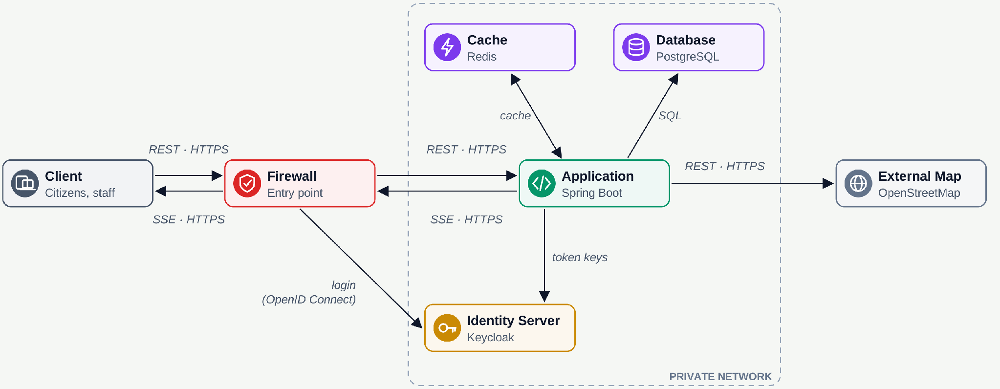
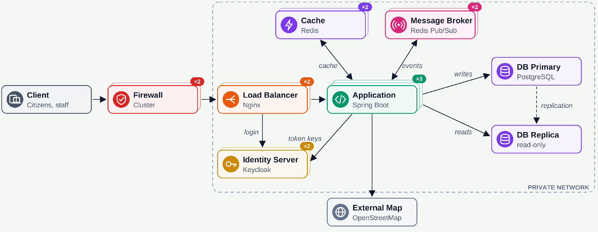
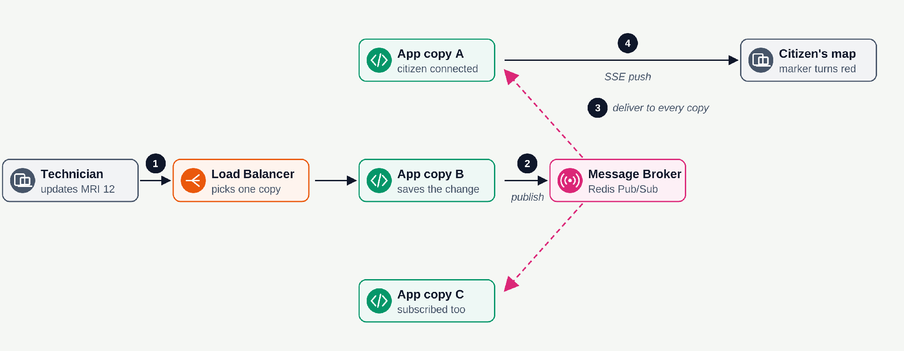
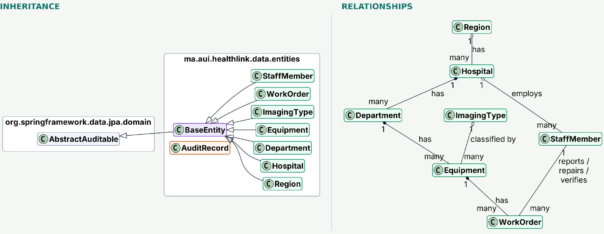
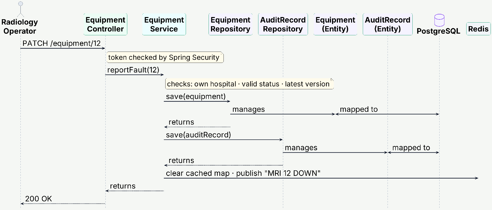

# HealthLink

### Find a working imaging service. Keep the repair cycle accountable.

**A cloud-oriented platform for public-hospital imaging availability in Morocco.**

HealthLink connects citizens, hospital teams, and Ministry officers around one question: **where is the nearest public hospital with a working imaging service?** Citizens discover services on a live map; hospital teams report faults, coordinate maintenance, and verify repairs; Ministry officers monitor availability across hospitals and regions.

Developed at **Al Akhawayn University** for **CSC4309 — Cloud Enterprise & Mobile Applications**, Fall 2026.

> **Project status:** In development. This README describes the intended architecture and functional scope from the project report. Performance, high availability, and production-readiness objectives are targets, not verified deployment guarantees. Setup details must match the configuration committed to this repository.

[Overview](#overview) · [Features](#features) · [Architecture](#architecture) · [Domain model](#domain-model) · [Getting started](#getting-started) · [Roadmap](#roadmap)

## Overview

Finding a hospital is not the same as finding a working MRI, CT scanner, X-ray machine, or ultrasound service. Equipment faults, maintenance, and fragmented status information make that distinction important.

HealthLink focuses on **equipment availability and the complete repair cycle**. A machine reported as faulty must not return to the public availability map simply because someone marked its repair as complete: an authorized manager must verify the repair first.

The application is designed as a **modular Spring Boot monolith** with a React Progressive Web App, PostgreSQL/PostGIS, Keycloak, and Redis. Multiple stateless application instances can serve requests while sharing status-change events through Redis Pub/Sub.

### Scope

| Core capabilities | Supporting capabilities | Outside the current scope |
| --- | --- | --- |
| Equipment status and verified maintenance | Hospitals and departments | Appointment booking |
| Nearby imaging-service discovery | Staff accounts and permissions | Patient records |
| Live public-map updates | Ministry availability dashboard | Clinical diagnosis or treatment |
| Traceable status changes | Regions and imaging types | Ambulance tracking, reserved for future expansion |

Equipment availability indicates operational readiness; it is **not an appointment, a guaranteed same-day scan, or confirmation of clinical eligibility**.

## Features

### Citizens

- Search public hospitals by imaging type without creating an account.
- Find nearby hospitals using geographic distance.
- View current imaging availability and its last-update time.
- Receive status changes while the map is open.
- Retain the last loaded view offline, clearly marked as potentially stale.

### Hospital teams

- Register equipment and associate it with a hospital department and imaging type.
- Report equipment faults and initiate maintenance work orders.
- Accept repairs, record completion, and submit them for verification.
- Verify or reject repairs before restoring operational availability.
- Inspect equipment and maintenance history within authorized organizational boundaries.

### Ministry and platform administration

- View availability by hospital, region, or country.
- Onboard hospitals and hospital managers.
- Maintain organizational reference data without granting unrestricted equipment access.

### Roles and boundaries

| Actor | Responsibilities | Access boundary |
| --- | --- | --- |
| Citizen | Search imaging services and view public availability | Public information only |
| Radiology operator | Update equipment status and report faults | Own department |
| Maintenance technician | Accept and complete repairs | Own hospital |
| Hospital manager | Register equipment, manage staff, verify or reject repairs | Own hospital; no self-verification |
| Ministry officer | Read availability summaries | Assigned region or national scope |
| Platform administrator | Register hospitals and provision manager accounts | No equipment access by default |

Role checks are combined with department and hospital ownership checks in the service layer. Possessing a role alone does not grant access to every hospital.

## Architecture

### Components and communication



| Component | Responsibility |
| --- | --- |
| React PWA | Citizen map and role-specific staff interfaces |
| Nginx | Reverse proxy, load balancing, and support for long-lived SSE connections |
| Spring Boot | REST API, business rules, authorization, transactions, and event delivery |
| PostgreSQL + PostGIS | Authoritative relational data and geographic distance queries |
| Redis cache | Cache map-query results to reduce repeated database work |
| Redis Pub/Sub | Distribute live notifications between running application instances |
| Keycloak | Staff authentication and token issuance through OpenID Connect |
| Spring Security | Validate tokens and enforce application access rules |
| OpenStreetMap ecosystem | Geographic map data and an appropriately configured map service |

REST requests and Server-Sent Events use HTTPS. PostgreSQL remains the source of truth; Redis notifications are not the durable record of an equipment change. OpenStreetMap data and any tile service used by the client require appropriate attribution and usage-policy compliance.

### Deployment and availability target



The target deployment distributes requests across multiple stateless application instances. PostgreSQL writes go to the primary, with replication supporting recovery and potential promotion of a replica.

**Replication alone does not establish automatic failover or eliminate all single points of failure.** Production deployment must configure and test health checks, traffic failover, database promotion, Redis and identity-service recovery, backups, and restore procedures. The diagram expresses the intended topology, not a claim that these mechanisms are already implemented.

Long-lived SSE connections require suitable proxy timeout and buffering settings. Existing clients must reconnect if their application instance becomes unavailable.

### Live updates across application instances



1. A staff request reaches one application instance through the load balancer.
2. The service validates the change and commits the equipment update and audit record.
3. After a successful commit, cached availability is invalidated and a notification is published through Redis Pub/Sub.
4. Each subscribed application instance receives the notification.
5. Instances forward relevant updates to their connected clients through SSE.

Redis Pub/Sub does not retain missed messages. A reconnecting client reloads the authoritative state through REST rather than assuming that every event was delivered. Implementations should also reconcile periodically and handle events arriving during a snapshot refresh.

For stronger delivery guarantees, a transactional outbox is a future hardening option: it closes the failure window between committing a database change and publishing its notification. Audit history must never depend solely on Pub/Sub delivery.

## Domain model



| Entity | Purpose |
| --- | --- |
| `Region` | Geographic grouping of hospitals |
| `Hospital` | Public healthcare organization and staff boundary |
| `Department` | Hospital unit responsible for equipment |
| `ImagingType` | Extensible catalog of imaging services |
| `Equipment` | Individual machine and its operational state |
| `StaffMember` | Staff identity, organizational affiliation, and role data |
| `WorkOrder` | Maintenance process linking reporter, repairer, and verifier |
| `AuditRecord` | Durable history of relevant business actions |

### Shared entity metadata

Business entities inherit from `BaseEntity`, which supplies an identifier and an `active` flag. The report places this base class above Spring Data's `AbstractAuditable` to share creation and last-modification metadata. `AuditRecord` is a separate exception to the ordinary mutable-entity lifecycle.

**Proposed identifier convention:** Java `UUID` values stored in PostgreSQL `uuid` columns, consistently used in repository types, DTOs, URL parameters, and references. The UUID generation strategy must be explicit; UUID identifiers are not an authorization mechanism.

The `active` flag supports deactivation where business rules require it. Deactivation and deletion must not silently erase maintenance or audit history.

### Business invariants

- A department belongs to a hospital and cannot exist without one.
- Equipment belongs to a department and is classified by an imaging type.
- Redrawing regional boundaries must not delete hospitals or their history.
- A work order identifies who reported, repaired, and verified the fault.
- A repairer cannot verify their own repair, even if they hold multiple roles.
- Only valid state transitions can change operational availability.
- Concurrent updates must be checked against the latest entity version.
- Public availability is computed from relevant equipment and workflow state, rather than maintained as an unrelated manual flag.

Imaging types are database entities, allowing a new imaging category to be introduced as data rather than a new Java enum constant.

## Repair workflow

1. **Report:** an authorized operator reports a fault on equipment in their department.
2. **Validate:** the service checks ownership, transition rules, and the submitted version.
3. **Remove from availability:** the affected equipment is no longer counted as operational.
4. **Repair:** a technician accepts the work and records its completion.
5. **Verify:** an authorized manager verifies or rejects the repair; self-verification is blocked.
6. **Restore:** successful verification allows the equipment to return to the available pool.
7. **Trace and notify:** accepted changes produce audit history and refreshed public availability.

These are workflow stages, not a declaration of the exact enum names used in code.

### Service-driven request sequence



Controllers handle HTTP input and responses. Services own business rules and transaction boundaries. Repositories persist entities. DTOs define API representations, with MapStruct handling structural mapping rather than authorization or business validation.

The supplied sequence diagram is conceptual: equipment and audit writes must commit together, and external notifications must follow a successful commit. A failed transaction must not announce a successful status change.

## Auditability and security

Creation and last-modification fields answer who last changed an entity. A separate audit trail answers **what happened throughout its history**.

A proposed audit entry contains an event identifier, entity type and identifier, action, authenticated actor, occurrence timestamp, relevant change details, and a request or workflow correlation identifier. Sensitive values must be excluded or minimized.

- Keep audit records append-only through application behavior and database permissions.
- Preserve history when a business entity is deactivated or removed.
- Commit successful business changes and their audit entries atomically.
- Record authentication and rejected-access events through a suitable security logging path, including events whose business transaction rolls back.
- Validate token signatures, issuer, audience, and expiry; enforce organizational access on the server.
- Keep staff credentials in the identity provider rather than application-owned password tables.
- Request consent for location use and avoid persisting citizen coordinates. Review access logs and telemetry so location is not retained indirectly.
- Use synthetic data for classroom demonstrations; patient records remain outside scope.

The project report considers Moroccan Laws 05-20 and 09-08 and the DNSSI as governance context. Applicable obligations, retention periods, and deployment requirements require validation before production use; this project documentation is not a compliance certification.

## Technology stack

| Layer | Selected technology |
| --- | --- |
| Backend | Java 17, Spring Boot, Spring MVC |
| Persistence | Spring Data JPA, Hibernate, PostgreSQL, PostGIS |
| API mapping and validation | MapStruct, Jakarta Bean Validation |
| Client | React Progressive Web App |
| Identity and authorization | Keycloak, OpenID Connect, Spring Security |
| Cache and live events | Redis cache, Redis Pub/Sub, SSE |
| Reverse proxy | Nginx in the target architecture |
| Packaging and deployment | Docker and Docker Compose |
| Geographic data | OpenStreetMap |

Exact dependency versions and deployed services are defined by the repository's build and deployment files. The production topology may differ from the smaller local development stack.

## Getting started

### Prerequisites

- Git.
- Docker Engine or Docker Desktop with Docker Compose support.
- Java 17 for running the backend outside Docker.
- The Node.js version required by the frontend's package configuration, when running it locally.

### Clone the repository

```bash
git clone https://github.com/Walker974/HealthLink.git
cd HealthLink
```

### Configure the local environment

Before starting, inspect the committed Compose file, Spring configuration, and any environment example. Supply the values those files require for:

| Configuration area | Required information |
| --- | --- |
| Database | Host, port, database name, credentials, and PostGIS availability |
| Identity | Keycloak realm, client configuration, issuer, and audience |
| Redis | Endpoint and authentication where configured |
| Frontend | API base URL, identity settings, and allowed origins |
| Map service | Provider settings and attribution |

Do not commit real passwords, tokens, or production configuration. Environment-variable names, service names, ports, and realm import paths must be taken from the actual repository; they are not specified by the project report.

### Start the configured Docker services

From the directory containing the Compose file:

```bash
docker compose config --quiet
docker compose up -d --build
docker compose ps
docker compose logs --tail=100
```

These commands start only the services present in that Compose configuration. If the frontend or identity provider is not included, start it using its own committed instructions. Use the configured ports to determine the application URL.

To stop the environment while retaining persistent volumes:

```bash
docker compose down
```

### Run the backend outside Docker

If the backend includes a Gradle wrapper, run these from its directory after configuring its dependencies:

```bash
./gradlew bootRun
```

Windows PowerShell:

```powershell
.\gradlew.bat bootRun
```

Run the project's existing automated tests with `./gradlew test` or `.\gradlew.bat test`. Frontend commands must match the scripts and lockfile committed with the frontend. These instructions are a configuration-aware starting point; they have not been validated against a repository checkout for this README.

## Quality targets and verification

| Objective | Target from the report | Verification approach |
| --- | --- | --- |
| Client performance | Lighthouse score of at least 80 | Record category, device profile, and test conditions |
| Search latency | 2 seconds or less | Measure end-to-end searches with representative data and load |
| Live-update latency | 5 seconds or less | Measure from accepted change to an open client's update |
| Horizontal scaling | Add application instances | Verify routing and shared event delivery across instances |
| Availability | Continue serving after an instance failure | Exercise failure, reconnection, and failover scenarios |
| Offline behavior | Retain the last view | Verify cached content and visible staleness indicators |

Before treating these targets as achieved, define workload, percentile, dataset size, and network conditions, and publish measured results.

Priority tests include cross-hospital access rejection, repairer self-verification rejection, invalid transitions, optimistic-lock conflicts, transactional audit persistence, SSE reconnection, cache invalidation, and restoration from backup.

## Suggested code organization

Organize the backend by business module, with focused controllers, services, repositories, DTOs, and mappers inside each module. The following is a proposed responsibility split, not an assertion about the current filesystem layout:

| Module | Responsibilities |
| --- | --- |
| `organization` | Regions, hospitals, and departments |
| `equipment` | Equipment registration, imaging types, and operational state |
| `maintenance` | Work orders, repair completion, and verification |
| `staff` | Staff profiles and organizational assignments |
| `availability` | Public geographic searches and availability projections |
| `audit` | Append-only business history |
| `shared` | Base entity and narrowly shared infrastructure |

Keep service responsibilities cohesive; a single module may contain separate hospital, region, and department services. Avoid making a generic shared service responsible for every entity.

## Roadmap

The following are delivery milestones; their completion must be tracked against the actual implementation.

1. Establish the domain model, migrations, validation, and identifier convention.
2. Implement organization and equipment management with scoped authorization.
3. Complete fault reporting, maintenance, independent verification, and audit history.
4. Deliver PostGIS-based public searches and the React map.
5. Add Redis cache invalidation and SSE updates across instances.
6. Deliver Ministry summaries and offline-view behavior.
7. Validate security boundaries, performance targets, backup restoration, and failure recovery.
8. Harden event delivery and production operations where required.

## Team and academic context

- **Authors:** Idriss Cherki & Ilyass Ourabine.
- **Supervisor:** Dr. Omar Iraqi.
- **Institution:** Al Akhawayn University, School of Science and Engineering.
- **Course:** CSC4309 — Cloud Enterprise & Mobile Applications.
- **Semester:** Fall 2026.